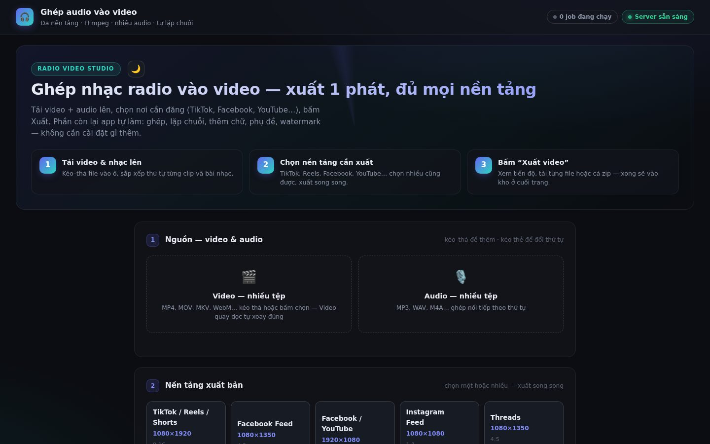
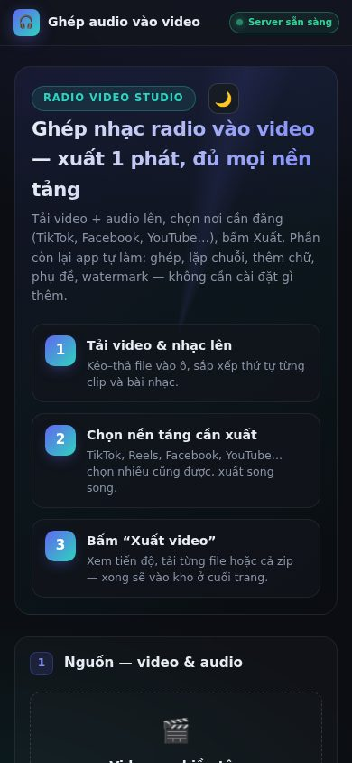

# 🎧 Radio Video Studio

**Ghép audio radio vào video và xuất đồng loạt cho mọi nền tảng — TikTok, Reels, YouTube Shorts, Facebook, Instagram, Threads, X — chỉ bằng 1 cú bấm.**

Web app chạy local (Rust + Axum + FFmpeg): tải binary về, mở trình duyệt, dùng. Không cloud — toàn bộ xử lý trên máy bạn, không có file nào được gửi đi đâu.


## ✨ Tính năng

| Nhóm | Chi tiết |
| --- | --- |
| 🎬 **Ghép video + audio** | Nhiều clip, kéo–thả sắp thứ tự. Nhiều file audio nối tiếp. Chuỗi video **tự lặp** cho hết bài nhạc, cắt đúng thời lượng audio, bỏ tiếng gốc. |
| 📱 **9 preset nền tảng** | TikTok 9:16, Facebook Feed 4:5, Facebook/YouTube 16:9, Instagram 1:1, Threads 4:5, X 16:9, giữ nguyên gốc, tuỳ chỉnh W×H. Chọn nhiều → **render song song**. |
| 🔀 **Chuyển cảnh** | xfade giữa các clip: fade / smoothleft / circleopen / dissolve, thời lượng 0–1s. |
| 🎞️ **3 chế độ khớp khung** | Che lấp (crop) · viền đen (pad) · nền mờ (blur). |
| ✍️ **Chữ overlay** | Tiêu đề chương trình: font hệ thống hoặc upload `.ttf`/`.otf`, cỡ/màu/viền, vị trí trên/giữa/dưới, hẹn giờ hiện từ–đến. Escape an toàn `:` `'` `\` `%` + UTF-8 tiếng Việt. |
| 💬 **Phụ đề burn-in** | **Tự động nhận diện giọng nói (ASR)** sinh phụ đề — hoặc dùng tệp `.srt` sẵn. Màu hex tự đổi sang ASS `&H00BBGGRR&`. |
| 💧 **Watermark** | Tên kênh (text) hoặc logo PNG/JPG/WEBP; 5 vị trí, độ đục, lề; chế độ **di chuyển 4 góc chống crop**; tự né **safe-zone** từng nền tảng. |
| 🎚️ **Audio** | Âm lượng 0–200%, fade-out cuối bài, chế độ nhanh (giữ codec). Bật lớp overlay thì fast-mode tự tắt (filter buộc re-encode) — UI cảnh báo ngay. |
| 👀 **Xem trước trực tiếp** | Khung đúng tỉ lệ preset + safe-zone + chữ + watermark render bằng CSS ngay trong app, chưa cần ffmpeg. |
| 📼 **Kho video** | Section cuối trang, tự nạp sau mỗi lần xuất: xem trực tiếp (stream hỗ trợ Range/seek), tải xuống, xoá. |
| 🌗 **Giao diện** | Dark/Light theo hệ điều hành, responsive từ 375px, tiếng Việt, **1 luồng tuyến tính 5 bước** (Nguồn → Nền tảng → Xem trước → Tuỳ chọn → Xuất) + kho video ở cuối — chỉ đúng 1 nút Xuất trên toàn trang. |

### Xử lý "cứng" các edge-case thực tế

- **Video quay điện thoại** (rotation metadata) → tự xoay đúng chiều trước khi scale/crop.
- **VFR** (variable frame rate), **4K**, **MKV/WebM/MOV/VP9** → chuẩn hoá tự động.
- File hỏng / giả mạo đuôi `.mp4`/`.mp3` → từ chối với thông báo rõ ràng, không treo.
- Font tiếng Việt: tự sinh `fonts.conf` cho ffmpeg, không lỗi ô vuông.
- Job lỗi/song công đều tự dọn workspace — không phình đĩa.
- Preset thêm/sửa bằng `presets_config.json` — **không cần build lại**.



## 🚀 Chạy app

### Yêu cầu

- **FFmpeg + FFprobe** trong `PATH`:

  | Hệ điều hành | Lệnh |
  | --- | --- |
  | Windows (PowerShell) | `winget install ffmpeg` |
  | macOS | `brew install ffmpeg` |
  | Linux (Debian/Ubuntu) | `sudo apt install ffmpeg` |

- [Rust](https://rustup.rs/) 1.75+ — **chỉ cần khi build từ source**.

### Từ source

```bash
git clone <repo-url>
cd radio-video-merger
cargo run --release
# Mở http://127.0.0.1:3000 (app tự mở trình duyệt)
```

### Biến môi trường

```bash
RVM_PORT=8080 ./radio-video-merger            # đổi cổng (mặc định 3000)
RVM_MAX_PARALLEL=2 ./radio-video-merger       # giới hạn render song song
RVM_FFMPEG_PATH=/path/ffmpeg \
RVM_FFPROBE_PATH=/path/ffprobe ./radio-video-merger   # ffmpeg đặt chỗ khác
```

Frontend nhúng thẳng trong binary — 1 file chạy được, không cần nginx.

## 🧩 Kiến trúc & pipeline

```
clips  →  [1] chuẩn hoá từng clip (áp rotation, W×H, fps, yuv420p, -an)
       →  [2] ghép: concat (-c copy)  hoặc  chuỗi xfade (re-encode)
       →  [3] dựng OverlaySpec theo FrameCtx preset (subtitles → drawtext → wm text → logo)
       →  [4] -stream_loop -1 + audio radio + volume/fade + -t <audio_dur> + burn overlay
```

| File | Trách nhiệm |
| --- | --- |
| `src/main.rs` | Khởi động, graceful shutdown (kill ffmpeg, dọn workspace). |
| `src/routes.rs` | HTTP API + stream Range + library + multipart streaming xuống đĩa. |
| `src/jobs.rs` | Job cha (1 upload) → job con (1 preset), semaphore song song, ASR autosub, cleanup. |
| `src/ffmpeg.rs` | Xây lệnh ffmpeg/ffprobe — hàm thuần, unit test từng preset × fit mode. |
| `src/textover.rs` | drawtext / subtitles / watermark — biên filter, escape an toàn, safe-zone. |
| `src/presets.rs` | 9 preset builtin + override/thêm từ `presets_config.json`. |
| `src/zipwriter.rs` | Zip writer "stored" tự viết (CRC32, local header, central dir). |
| `src/fontconfig.rs` | Liệt kê font hệ thống + sinh fonts.conf cho ffmpeg. |
| `static/index.html` | Toàn bộ UI (SPA thuần, không build step). |

Ví dụ filter `pad` cho TikTok 1080×1920:

```
[0:v]scale=w='min(1080,iw*1920/ih)':h='min(1920,ih*1080/iw)':
force_original_aspect_ratio=decrease:force_divisible_by=2,
pad=1080:1920:(ow-iw)/2:(oh-ih)/2:color=black[v]
```

## 🔌 API

| Method | Endpoint | Chức năng |
| --- | --- | --- |
| `GET` | `/api/presets` | Danh sách preset (+ safe-zone, max duration). |
| `GET` | `/api/fonts` | Font hệ thống cho dropdown. |
| `POST` | `/api/jobs` | Tạo job: multipart `videos`* + `audio`* + `subtitle?` + `logo?` + `font?` + `options` (JSON). |
| `GET` | `/api/jobs/{id}` | Trạng thái + tiến độ từng preset. |
| `POST` | `/api/jobs/{id}/cancel` | Huỷ job (kill toàn bộ ffmpeg con). |
| `GET` | `/api/jobs/{id}/download` | Zip tất cả output (≥2 preset) hoặc file duy nhất. |
| `GET` | `/api/jobs/{id}/download/{preset}` | Tải 1 output. |
| `GET` | `/api/jobs/{id}/stream/{preset}` | Stream inline hỗ trợ Range (seek được). |
| `GET` | `/api/library` | Kho output đã xuất. |
| `GET` | `/api/library/{job}/{preset}/stream` · `/download` | Stream/tải từ kho. |
| `DELETE` | `/api/library/{job}/{preset}` | Xoá khỏi kho. |

Ví dụ `options`:

```json
{
  "volume": 80, "fade_out": 1, "fast_mode": false, "fit_mode": "pad",
  "xfade_duration": 0.5, "xfade_transition": "fade",
  "presets": [ {"id": "tiktok_9x16"}, {"id": "custom", "custom_width": 500, "custom_height": 500} ],
  "text":     { "enabled": true, "content": "Radio: 100% don't stop!", "size_px": 48,
                "color": "#FFE082", "border_w": 4, "position": "top", "start_sec": 1, "end_sec": 6,
                "font": {"kind": "system", "family": "Noto Sans"} },
  "subtitle": { "enabled": true, "auto": true, "font_size": 30, "color": "#FFFF00" },
  "watermark":{ "enabled": true, "kind": "text", "channel_name": "@Kenh.Radio.99",
                "size_px": 36, "opacity_pct": 70, "margin_px": 24,
                "position": "bottom_right", "moving": false, "logo_scale_pct": 18 }
}
```

`fit_mode`: `cover|pad|blur` · `position` chữ: `top|middle|bottom` · watermark: `top_left|top_right|bottom_left|bottom_right|center` · `font.kind`: `default|system|upload`.

## 🧪 Kiểm thử

```bash
cargo test --release   # 94 unit test
```

Phạm vi: filter args từng preset × fit mode, offset xfade cộng dồn, escape hex↔ASS, drawtext/subtitles/watermark 5 vị trí + safe-zone + moving `mod(t/N,4)`, logo graph, zip CRC32, preset override, rotation 90/180/270, JSON brace-matching, cắt theo `max_duration_sec` (kể cả tính lại fade-out).

Bộ E2E encode thật (`scripts/`): input xoay metadata, VFR, 4K, MKV/WebM/MOV, file giả đuôi, SRT lệch, logo JPG, 7 preset song song, ASR autosub burn-in (verify pixel), 39 test UI trên browser thật (bố cục 1 cột, kho tự nạp, responsive 375px), stream Range + MD5, huỷ job.

## 🔧 Nâng cấp bản 0.3 (24/11) — Thư viện mẫu chữ

- **🎨 12 mẫu chữ chuyên nghiệp — bấm là áp dụng**: Cổ điển · Tin nóng · Neon · Karaoke · Podcast · Chat radio · Thể thao · Retro 3D · Trích dẫn · Tối giản · Cảnh báo · Đêm muộn. Gallery trực quan ngay đầu tab Chữ overlay, xem trước cập nhật tức thì.
- **Nền chữ (box)**: màu tuỳ chọn + độ đục 10–100% + đệm 4–48px — chính là kiểu banner tin nóng.
- **Bóng đổ**: độ lệch 1–12px, màu tuỳ chọn.
- **Độ rộng ký tự (letter-spacing)**: giãn chữ kiểu TIN NÓNG / ticker, 0–16px.
- **VIẾT HOA** toàn bộ nội dung 1 checkbox.
- **Lớp accent 2 màu (3D/neon)**: lớp chữ màu thứ 2 lệch dưới lớp chính — hiệu ứng Neon cyan, Retro hồng.
- **Xem trước CSS đồng bộ 100%**: viền, nền, bóng, spacing, HOA, accent đều hiện đúng trong khung preview trước khi render.
- Responsive: gallery tự 2 cột trên mobile 375px, không tràn ngang.
- Kiểm chứng: **101 unit test** (7 test mới cho style) + E2E render thật verify pixel (accent cyan + box đỏ đều hiện trong frame output).

## 🔧 Nâng cấp bản 0.2 (24/11)

- **Cắt đúng giới hạn thời lượng nền tảng**: `max_duration_sec` của preset (TikTok 3:00, Instagram 1:30, X 2:20, Kênh riêng 1:00) giờ được áp dụng ở pass cuối — bản xuất dài đúng chuẩn, fade-out tính lại để kết thúc tại điểm cắt. Trước đây video xuất dài bằng audio, dễ bị nền tảng từ chối.
- **UI cảnh báo trước khi render**: chọn preset có giới hạn mà audio dài hơn → hiện ngay "bản xuất sẽ được cắt còn 3:00 (đúng chuẩn nền tảng)".
- **API nhận cả 2 dạng options**: dạng flat (`volume`, `fade_out`, `fast_mode` ở gốc — UI hiện tại) và dạng lồng (`"audio": {...}` — tiện client ngoài). Trước đây dạng lồng bị bỏ qua im lặng.
- **Validate âm lượng & fade sớm**: `volume` ngoài 0–200% hay `fade_out` ngoài 0–5s trả HTTP 400 ngay, không còn mặc định ngầm.
- **Whitelist hiệu ứng chuyển cảnh**: 18 transition xfade an toàn mọi bản ffmpeg 5/6/7; tên lạ bị chặn 400 kèm danh sách gợi ý thay vì để ffmpeg lỗi mơ hồ giữa chừng.

## ⚙️ Cấu hình preset

`presets_config.json` (cạnh file chạy) — đè preset builtin hoặc thêm mới không cần build:

```json
{
  "presets": {
    "tiktok_9x16": { "max_duration_sec": 180 },
    "kenh_rieng_1x1": {
      "name": "Kênh riêng", "ratio": "1:1",
      "width": 720, "height": 720, "max_duration_sec": 60
    }
  }
}
```

## ⚠️ Hạn chế đã biết

- Preset "Giữ nguyên gốc" yêu cầu các clip cùng độ phân giải (backend báo lỗi rõ nếu lệch).
- `fast_mode` chỉ áp dụng pass cuối; chuẩn hoá/ghép vẫn transcode. Có lớp overlay thì tự tắt hoàn toàn.
- Safe-zone là ước lượng theo UI từng nền tảng tại thời điểm viết — chỉnh trong `presets_config.json`.
- Font upload cho **phụ đề** chưa áp dụng được (subtitles dùng `FontName` qua fontconfig).
- Watermark moving xoay 4 góc theo chu kỳ cố định.

## 📄 License

MIT — xem [LICENSE](LICENSE).

## 🙏 Cảm ơn

- [FFmpeg](https://ffmpeg.org/) — trái tim của mọi thứ.
- [Axum](https://github.com/tokio-rs/axum) / [Tokio](https://tokio.rs/) — async runtime.
- [z-ai-web-dev-sdk](https://www.npmjs.com/package/z-ai-web-dev-sdk) — ASR phụ đề tự động.



## Bản 0.4 — rà soát mã nguồn

Danh sách bug đã sửa, tính năng mới và những phần chưa làm xem ở `RELEASE-0.4.md`.
